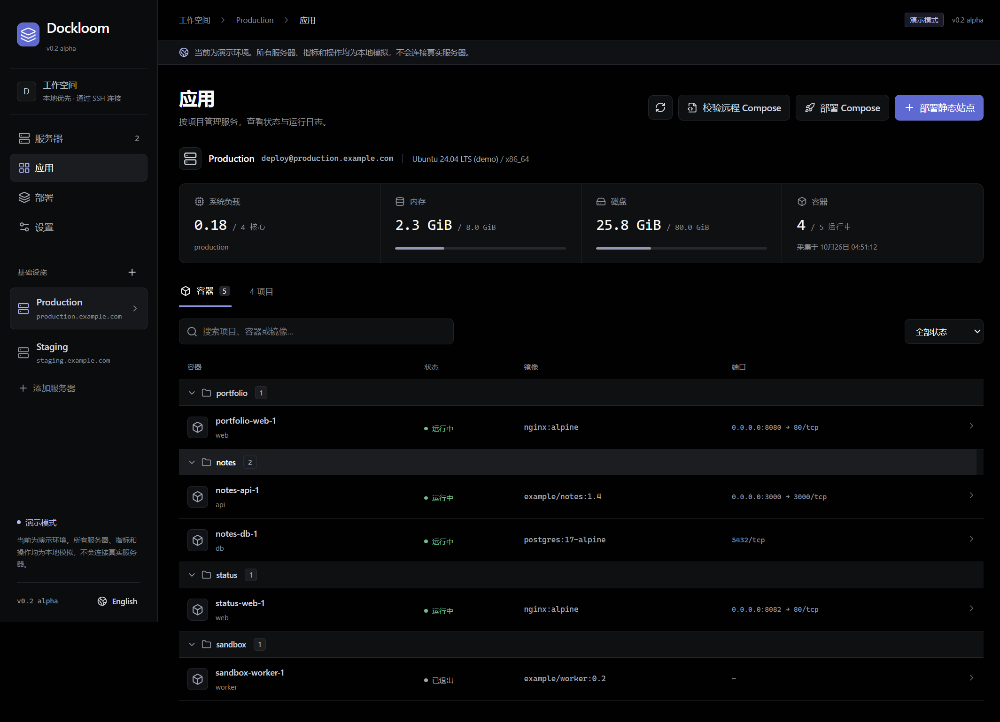

# Dockloom

A local-first desktop workspace for your Docker servers. Connect over SSH, discover Compose projects, inspect logs, and publish static sites or multi-service Compose applications with version history and rollback.

**v0.2 alpha · Windows desktop · MIT**

[简体中文](README.zh-CN.md) · [Architecture](docs/architecture.md) · [Security](SECURITY.md) · [Contributing](CONTRIBUTING.md)



## What works in this alpha

- Multiple saved SSH connections: host aliases or manual host/port/user/key configuration.
- Host resources, Docker/Compose capability checks, existing project and container discovery.
- Container logs, start, stop and restart, scoped to the selected container.
- Static directory deployment with a review step, static/SPA mode and configurable binding/port.
- Versioned static releases, health verification, rollback and server-side task records.
- Compose releases from local source: ordered configuration and environment files, profiles, local Dockerfile builds, image pinning, health verification and rollback.
- Project-scoped named volumes that persist across updates and rollback.
- Read-only validation of existing Compose files without rewriting them.
- Chinese/English interface and an explicitly labeled, network-free demo mode.

The web preview is **demo-only**. Real SSH operations are available only through the desktop application's isolated preload bridge.

## Run from source

Requirements: Node.js **22.12+**, npm, and OpenSSH client on your computer.

```sh
npm ci
npm run dev
```

To build and launch the packaged application code:

```sh
npm run build
npm start
```

Browser-only preview: `npm run dev:web`, then open `http://127.0.0.1:5173`.

Windows portable build: `npm run package`. Output is under `release/`. This alpha is unsigned.

## Connect your server

The remote host needs Linux, SSH, Python 3, Docker Engine and Docker Compose v2. The selected SSH user must already be able to access Docker and write to the selected deployment directory. Dockloom does not install Docker or change cloud firewall rules.

1. Connect in a terminal first, for example `ssh my-server`, and verify the host fingerprint. Dockloom enforces known-host verification and non-interactive key authentication.
2. Add the SSH alias or manual connection in the app. A key path or SSH agent is used; no private key is copied into the project.
3. Choose a dedicated deployment root, such as `~/deployments`.
4. Inspect the capability report, then deploy `examples/static-site` to an unused port.
5. Open the port in your cloud firewall if public access is desired. A local-only bind stays private.

Static input must contain `index.html`; this alpha accepts a directory, up to 32 MiB / 5,000 files, with no symlinks. Upload only built public assets, never a source repository containing secrets.

## Publish a Compose application

1. Select **Deploy Compose**, choose a local project directory and enter a new application name.
2. List Compose files in merge order, followed by any explicit environment files and profiles. Paths are relative to the selected directory. No implicit `.env` is loaded.
3. Review the resolved service list and warnings, then publish. Builds and image downloads run on the remote server.
4. Inspect the task and release history. Reuse the application name for updates, or select a prior release to roll back.

Try [the web + Redis example](examples/compose-stack/compose.yaml). It binds the website to the server's loopback address on port 8088; use an SSH tunnel or edit the bind address before publishing.

The Compose source limit is also 32 MiB / 5,000 files. `.git`, `node_modules` and unselected `.env*` files are excluded; other source files are uploaded, so choose the directory carefully. Environment files are stored privately on the remote server and frozen into each release. Add `.dockerignore` to keep them out of build contexts. See [supported Compose features](docs/compose.md).

## Scope and limitations

- Existing Compose projects are discovered and inspected. They are not automatically rewritten or converted into Dockloom-managed releases.
- Static sites and supported Compose applications created by Dockloom have deployment/rollback workflows. Compose is a supported subset: local builds, project networks, named volumes and read-only source binds; privileged/host-network services and writable binds are rejected.
- The enabled service set must stay the same across revisions. Use a new app name for service additions/removals. ZIP import, remote Git builds and database migration rollback are not implemented.
- Changes can briefly interrupt the affected application. Rollback restores image/configuration versions and preserves named-volume data; it is not a database backup or migration reversal.
- No always-on web panel or public Docker API is required. An authorized deployment creates a short-lived background task and private state under the selected remote root. Closing the app does not stop an already-started task.
- Local host checks and Docker health are distinct from public reachability. Cloud security groups are not managed by this release.
- macOS/Linux desktop packages and arm64 targets have not yet been certified. See [compatibility](docs/compatibility.md) for actual tests rather than assumed support.
- SSH Host aliases are listed from the main `~/.ssh/config`; aliases in Include files may be entered manually. The system SSH client still resolves its normal configuration.

## Verification

```sh
npm test
npm run build
npm run test:ui
npm run test:integration
```

The integration suite needs a local Linux-container Docker engine. It creates a **privileged, disposable Docker-in-Docker fixture** with its own SSH host and Docker daemon, and cleans up the fixture and its anonymous volume after the test. It does not connect to any production server. Fixture images remain cached for repeat runs.

## Roadmap

Service-set migration; ZIP uploads; platform-signed installers; macOS/Linux packaging; Git-based delivery. No telemetry, cloud account or hosted control plane is required.

This repository is intended to contain only source code and synthetic examples. Server records belong in the OS user-data directory. Never commit `.env`, private keys, real subscriptions or production logs.
