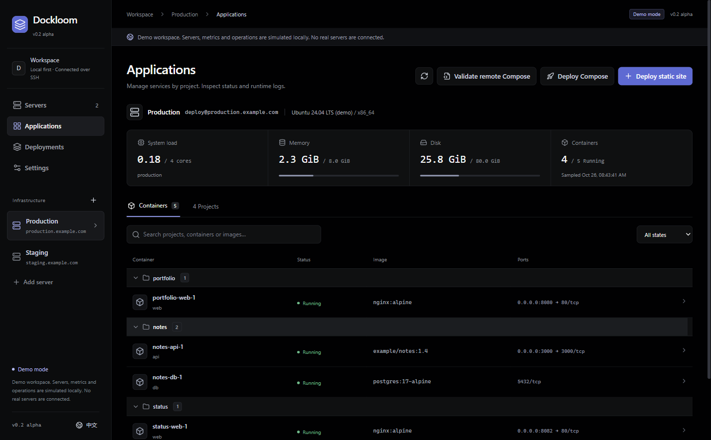
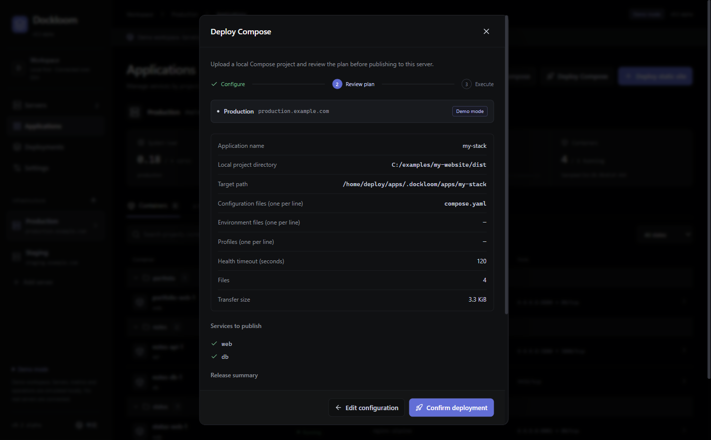
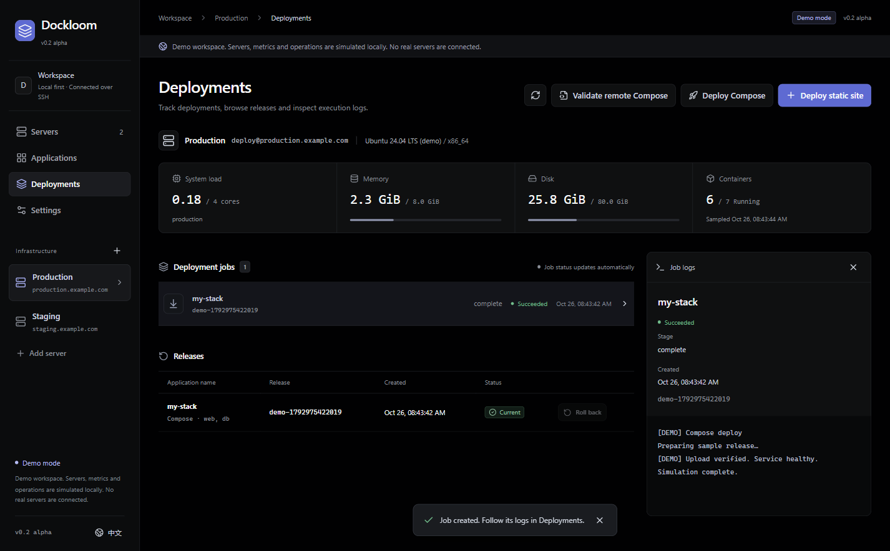
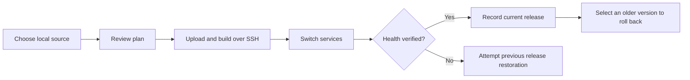
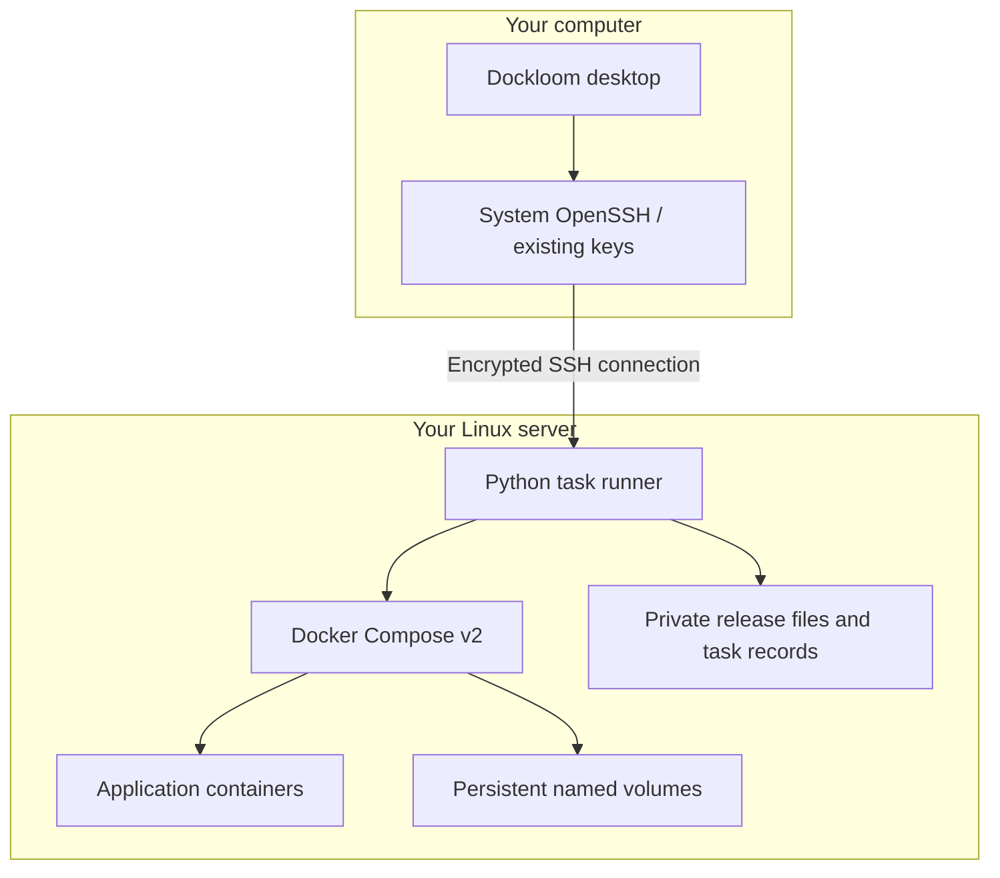

<div align="center">


# Dockloom

### Your servers. Your apps. One clear workspace.

**Connect over SSH. Review the plan. Ship with a version to return to.**

用一个桌面工作台，连接服务器、看清应用、发布新版本。

[English](README.md) · **[简体中文](README.zh-CN.md)**

[](https://github.com/stitchmaps/dockloom/actions/workflows/ci.yml)
[](LICENSE)
[](https://github.com/stitchmaps/dockloom/releases/tag/v0.2.0)
[](https://github.com/stitchmaps/dockloom/releases/tag/v0.2.0)

**[Download for Windows](https://github.com/stitchmaps/dockloom/releases/download/v0.2.0/Dockloom-0.2.0.exe)** · [Release & checksums](https://github.com/stitchmaps/dockloom/releases/tag/v0.2.0) · [Try an example](examples/compose-stack) · [Report an issue](https://github.com/stitchmaps/dockloom/issues)

</div>



Dockloom is a local-first desktop workspace for Docker servers. Bring your SSH connection and a built website or Compose project. See what's running, review what you're about to publish, and follow each release from deployment to health verification.

Built for personal servers, side projects and small self-hosted stacks. No Dockloom cloud account, public Docker API or always-on web panel is required.

> **v0.2 alpha:** Windows x64 portable app, currently unsigned. Supports a defined Compose subset. Rollback restores application images/configuration; it does not restore database contents.

## From a folder to a running application

| What you want to do | What Dockloom gives you |
| --- | --- |
| Understand a server at a glance | Host resources, capabilities, projects, containers and ports |
| Publish a website | Choose a built directory, port and static/SPA mode, then review and deploy |
| Ship a multi-service app | Ordered Compose files, environment files, profiles and remote Dockerfile builds |
| Know what happened | Persistent tasks, service health verification and release history |
| Return to an earlier version | Managed rollback and attempted restoration after a failed switch |
| Keep application data | Project-scoped named volumes retained across releases |
| Operate existing services | Logs, explicit start/stop/restart and read-only Compose validation |
| Explore before connecting | Chinese/English UI and a clearly labeled, network-free demo |

## See the workflow

### Review before you publish

Choose the local source and target server. Review the resolved services and warnings before confirming.



### Follow the task and keep the history

See deployment progress and recorded versions in one place. A task already submitted to the server continues if the desktop app closes; reconnect to inspect its result.



*Screenshots show the actual application using synthetic demo data. They illustrate the interface; real deployment verification is covered by isolated SSH/Docker integration tests.*



## How it connects

Dockloom runs on your computer. System OpenSSH connects to your Linux server, where Python and Docker Compose carry out the requested operation. Existing projects remain under their original management; only apps you publish through Dockloom get managed release history.



[Architecture](docs/architecture.md) · [Security](SECURITY.md) · [Contributing](CONTRIBUTING.md)

The web preview is **demo-only**. Real SSH operations are available only through the desktop application's isolated preload bridge.

## Run from source

Prefer a ready-to-run app? Download the [Windows portable release](https://github.com/stitchmaps/dockloom/releases/tag/v0.2.0), then follow the connection steps below.

Requirements: Node.js **22.12+**, npm, and OpenSSH client on your computer.

```sh
npm ci
npm run dev
```

To build and launch the packaged application code:

```sh
npm run build
npm start
```

Browser-only preview: `npm run dev:web`, then open `http://127.0.0.1:5173`.

Windows portable build: `npm run package`. Output is under `release/`. This alpha is unsigned.

## Connect your server

The remote host needs Linux, SSH, Python 3, Docker Engine and Docker Compose v2. The selected SSH user must already be able to access Docker and write to the selected deployment directory. Dockloom does not install Docker or change cloud firewall rules.

1. Connect in a terminal first, for example `ssh my-server`, and verify the host fingerprint. Dockloom enforces known-host verification and non-interactive key authentication.
2. Add the SSH alias or manual connection in the app. A key path or SSH agent is used; no private key is copied into the project.
3. Choose a dedicated deployment root, such as `~/deployments`.
4. Inspect the capability report, then deploy `examples/static-site` to an unused port.
5. Open the port in your cloud firewall if public access is desired. A local-only bind stays private.

Static input must contain `index.html`; this alpha accepts a directory, up to 32 MiB / 5,000 files, with no symlinks. Upload only built public assets, never a source repository containing secrets.

## Publish a Compose application

1. Select **Deploy Compose**, choose a local project directory and enter a new application name.
2. List Compose files in merge order, followed by any explicit environment files and profiles. Paths are relative to the selected directory. No implicit `.env` is loaded.
3. Review the resolved service list and warnings, then publish. Builds and image downloads run on the remote server.
4. Inspect the task and release history. Reuse the application name for updates, or select a prior release to roll back.

Try [the web + Redis example](examples/compose-stack/compose.yaml). It binds the website to the server's loopback address on port 8088; use an SSH tunnel or edit the bind address before publishing.

The Compose source limit is also 32 MiB / 5,000 files. `.git`, `node_modules` and unselected `.env*` files are excluded; other source files are uploaded, so choose the directory carefully. Environment files are stored privately on the remote server and frozen into each release. Add `.dockerignore` to keep them out of build contexts. See [supported Compose features](docs/compose.md).

## Scope and limitations

- Existing Compose projects are discovered and inspected. They are not automatically rewritten or converted into Dockloom-managed releases.
- Static sites and supported Compose applications created by Dockloom have deployment/rollback workflows. Compose is a supported subset: local builds, project networks, named volumes and read-only source binds; privileged/host-network services and writable binds are rejected.
- The enabled service set must stay the same across revisions. Use a new app name for service additions/removals. ZIP import, remote Git builds and database migration rollback are not implemented.
- Changes can briefly interrupt the affected application. Rollback restores image/configuration versions and preserves named-volume data; it is not a database backup or migration reversal.
- No always-on web panel or public Docker API is required. An authorized deployment creates a short-lived background task and private state under the selected remote root. Closing the app does not stop an already-started task.
- Local host checks and Docker health are distinct from public reachability. Cloud security groups are not managed by this release.
- macOS/Linux desktop packages and arm64 targets have not yet been certified. See [compatibility](docs/compatibility.md) for actual tests rather than assumed support.
- SSH Host aliases are listed from the main `~/.ssh/config`; aliases in Include files may be entered manually. The system SSH client still resolves its normal configuration.

## Verification

```sh
npm test
npm run build
npm run test:ui
npm run test:integration
```

The integration suite needs a local Linux-container Docker engine. It creates a **privileged, disposable Docker-in-Docker fixture** with its own SSH host and Docker daemon, and cleans up the fixture and its anonymous volume after the test. It does not connect to any production server. Fixture images remain cached for repeat runs.

The v0.2 code passed 27 core tests, actual Electron UI checks, Windows/Linux builds and the complete SSH/Docker deployment suite. [View the verified run →](https://github.com/stitchmaps/dockloom/actions/runs/40233275361)

To regenerate the bilingual screenshots after building: `node scripts/screenshots.mjs`. It uses a temporary profile and synthetic demo data.

## Roadmap

Service-set migration; ZIP uploads; platform-signed installers; macOS/Linux packaging; Git-based delivery. No telemetry, cloud account or hosted control plane is required.

This repository is intended to contain only source code and synthetic examples. Server records belong in the OS user-data directory. Never commit `.env`, private keys, real subscriptions or production logs.
