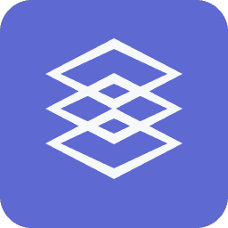
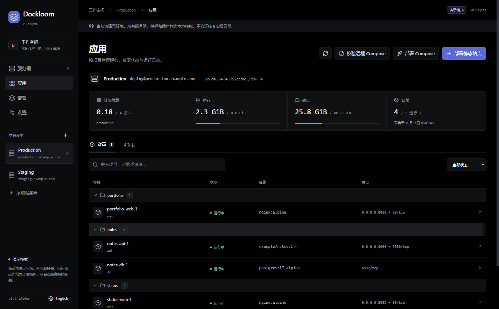
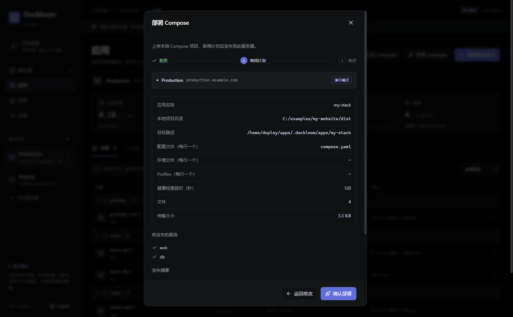
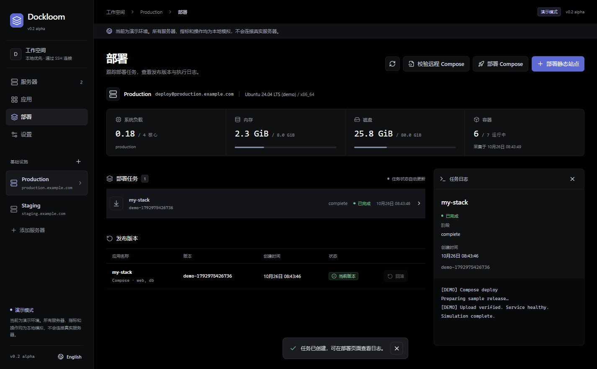
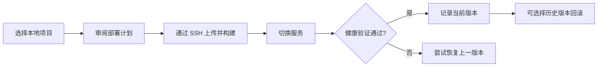
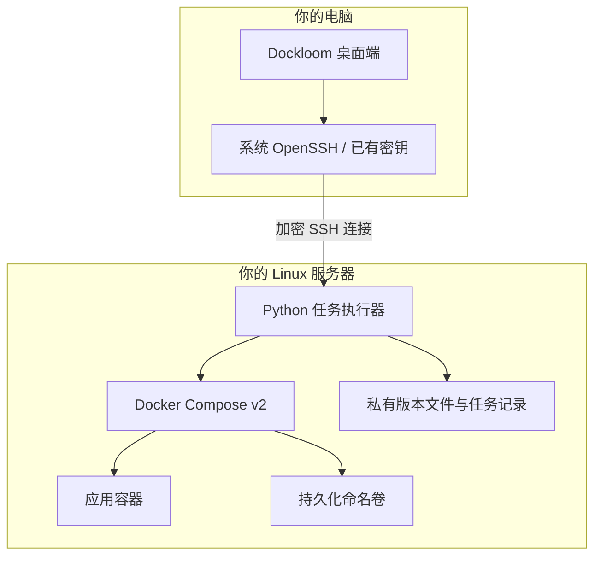

<div align="center">



# Dockloom

### 你的服务器，你的应用，一个清晰的工作台。

**连接 SSH，审阅计划，发布新版本，也留好回去的路。**

Your servers. Your apps. One clear workspace.

**[简体中文](README.zh-CN.md)** · [English](README.md)

[](https://github.com/stitchmaps/dockloom/actions/workflows/ci.yml)
[](LICENSE)
[](https://github.com/stitchmaps/dockloom/releases/tag/v0.2.0)
[](https://github.com/stitchmaps/dockloom/releases/tag/v0.2.0)

**[下载 Windows 便携版](https://github.com/stitchmaps/dockloom/releases/download/v0.2.0/Dockloom-0.2.0.exe)** · [发布页与校验文件](https://github.com/stitchmaps/dockloom/releases/tag/v0.2.0) · [体验示例](examples/compose-stack) · [反馈问题](https://github.com/stitchmaps/dockloom/issues)

</div>



从个人网站到多服务应用，把服务器上的日常操作收进一个桌面工作台。Dockloom 通过你已有的 SSH 连接，展示正在运行的应用，发布本地静态网站或 Compose 项目，并记录每次部署与验证结果。

适合管理个人服务器、独立项目和小型自托管服务。无需注册 Dockloom 云账号，无需开放 Docker API，也无需在服务器上常驻 Web 管理面板。

> **当前为 v0.2 alpha：** Windows x64 便携版，尚未签名。Compose 有明确的支持范围；版本回滚恢复应用镜像与配置，不恢复数据库内容。

## 从一个文件夹，到一个运行中的应用

| 你想做的事 | Dockloom 帮你完成 |
| --- | --- |
| 看清服务器上有什么 | 主机资源、部署能力、项目、容器和端口，一处查看 |
| 发布个人网站 | 选择构建目录，配置端口和静态/SPA 模式，审阅后发布 |
| 部署多服务应用 | 按顺序合并配置与环境文件，选择 Profiles，在远端构建镜像 |
| 知道这次发布发生了什么 | 查看任务进度、健康验证结果和历史版本 |
| 回到之前的版本 | 为托管应用回滚版本；切换失败时尝试恢复上一版 |
| 留住应用的数据 | 命名卷跨版本保留，应用发布与持久数据分开管理 |
| 操作已有服务 | 查看日志，明确选择启停或重启，只读校验已有 Compose |
| 先体验再连接 | 中英双语界面，明确标识、无需联网的演示模式 |

## 看得见的发布流程

### 发布前，先看清计划

选择本地目录、配置文件顺序和目标服务器。确认服务清单与警告后，再开始部署。



### 发布中看进度，发布后留版本

任务与历史版本集中展示。提交到服务器的任务会继续运行，即使关闭桌面端，也可以重新连接查看结果。



*以上是实际软件在演示模式下的截图，使用虚构服务器与示例数据。截图展示界面；真实部署能力由隔离 SSH/Docker 环境中的集成测试验证。*



## 它怎样连接服务器？

Dockloom 在你的电脑上运行，通过系统 OpenSSH 连接 Linux 服务器，再由远端 Python 任务与 Docker Compose 执行操作。已有项目维持原有管理方式；通过 Dockloom 发布的应用才会创建托管版本。



[架构说明](docs/architecture.md) · [安全说明](SECURITY.md) · [贡献指南](CONTRIBUTING.md)

## 启动

直接使用可下载 [Windows 便携版](https://github.com/stitchmaps/dockloom/releases/tag/v0.2.0)，打开后按下方步骤添加服务器。发布页同时提供源码和校验文件。

本机准备 Node.js 22.12+、npm 和 OpenSSH 客户端：

```sh
npm ci
npm run dev
```

构建后启动：`npm run build`、`npm start`。生成 Windows 便携版：`npm run package`，输出位于 `release/`。

`npm run dev:web` 是浏览器演示版；真实 SSH 操作只在桌面端执行。

## 首次连接

1. 服务器需已安装 Docker、Compose v2、Python 3，并运行 SSH 服务。
2. 先在终端执行 `ssh 你的别名` 或 `ssh 用户@地址`，核对并信任主机指纹。软件不会跳过主机验证。
3. 在软件内添加连接，选择有写权限的专用部署目录，例如 `~/deployments`。SSH 用户需要已有 Docker 使用权限。
4. 检查能力报告，选择 `examples/static-site`，填写空闲端口，审阅后发布。
5. 公网访问需要自己放行云平台安全组/防火墙；仅本机监听的站点不会直接对外开放。

静态目录必须有 `index.html`，最多 32 MiB、5,000 个文件，不接受符号链接。上传构建产物，不要选择包含密钥或 `.env` 的源码目录。

## 当前边界

静态网站与受支持的 Compose 应用均可发布、更新和回滚。已有其他应用支持发现、日志、容器启停和只读校验，不会被自动接管。Compose 支持本地构建、项目网络、命名卷、源目录内的只读挂载；不支持特权容器、主机网络、可写绑定挂载等高级选项，会在生成计划时明确拒绝。

同一个应用各版本的启用服务名称必须一致，增加或删除服务需使用新的应用名。ZIP 导入、远程 Git 构建、数据库迁移回滚尚未实现。详见 [Compose 使用说明](docs/compose.md)。

发布可能短暂重建目标服务；版本回滚不能替代数据库备份。关闭桌面端后已启动的远端任务继续运行，再次连接可查询结果。容器启动、本机健康和公网可达是不同状态，软件不自动管理云安全组。

服务器信息保存在系统用户数据目录，私钥只保存引用路径。公开源码不包含个人服务器资料。当前安装包未签名；其他桌面平台和 arm64 还需单独验证。

## 测试与贡献

`npm test` 执行核心测试，`npm run build` 执行类型检查和构建。`npm run test:ui` 验证实际 Electron 界面；`npm run test:integration` 在本机 Docker 中创建独立的 SSH + Docker 测试环境，验证实际部署、回滚与失败恢复。

集成测试使用带特权的临时 Docker-in-Docker 容器，仅用于开发测试；结束后清理测试容器及其匿名数据卷，保留构建镜像缓存。不会连接正式服务器。

v0.2 代码已通过 27 项核心测试、实际 Electron 界面测试、Windows/Linux 构建和完整 SSH/Docker 发布测试。[查看通过记录 →](https://github.com/stitchmaps/dockloom/actions/runs/40233275361)

构建后执行 `node scripts/screenshots.mjs` 可重新生成中英双语截图，使用临时用户目录与演示数据。

后续按需要扩展服务增删、离线包、域名与 HTTPS、其他桌面平台。欢迎提交可复现问题和小范围改进，详见 [CONTRIBUTING.md](CONTRIBUTING.md)。

## 发布 Compose 项目

1. 点击「部署 Compose」，选择本地目录，填写新的应用名称。
2. 按合并顺序填写配置文件名，例如 `compose.yaml`、`production.yaml`，每行一个。可填写环境文件和 Profiles，路径均相对所选目录，不会自动加载 `.env`。
3. 审阅服务清单及警告，确认后在远端构建、启动并验证。再次用同一应用名发布即可更新，版本页面可回滚。

可以先试 [网站 + Redis 示例](examples/compose-stack/compose.yaml)：默认监听服务器的 `127.0.0.1:8088`，通过 SSH 隧道访问，或部署前自行修改监听地址。

项目最多 32 MiB / 5,000 个文件，不支持符号链接；排除 `.git`、`node_modules` 和未明确选择的 `.env*`。其他文件会上传，请选好目录。环境文件随版本保存在远端私有目录，不会显示在计划里；自行添加 `.dockerignore`，避免把环境文件加入镜像构建上下文。
